# PUET.Pulse: як користуватися

Коротка інструкція для студентів, викладачів і працівників ПУЕТ. Скріншоти
зроблені на демонстраційних даних: імена й документи вигадані. Як
встановити месенджер на сервери, описано в [DEPLOYMENT.md](DEPLOYMENT.md).

## Вхід

1. Відкрийте адресу месенджера (наприклад, https://pulse.puet.edu.ua) у Chrome,
   Edge, Firefox або Safari. Також можна встановити його як застосунок: у
   браузері «Встановити застосунок» або десктопна версія від IT-центру.
2. Натисніть «Увійти через корпоративний SSO» і введіть логін і пароль
   університетського облікового запису.
3. Керівникам, працівникам фінансової та кадрової служб, служб довіри й
   адміністраторам потрібен другий фактор: код із застосунку-автентифікатора
   або апаратний ключ.

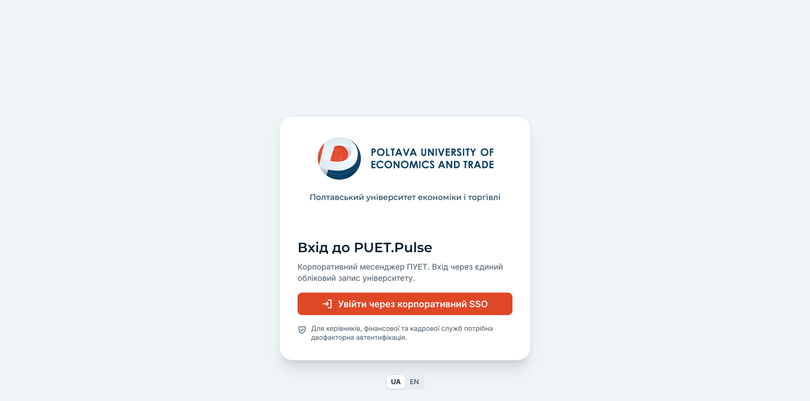
*Рис. 1. Сторінка входу: кнопка «Увійти через корпоративний SSO»*

Окремої реєстрації немає. Обліковий запис з'являється автоматично з кадрової
системи або ЄДЕБО. Якщо вхід не вдається, зверніться до IT-центру.

## Головний екран

Ліворуч розташовані розділи:

- **Чати** — канали й листування;
- **Консультації** — графік консультацій викладачів і запис на них;
- **Сервіси** — боти університетських служб;
- **Погодження** — документи, які чекають вашого рішення;
- **Налаштування**;
- **Адміністрування** (лише для адміністраторів).

Внизу можна перемкнути світлу або темну тему і вийти.

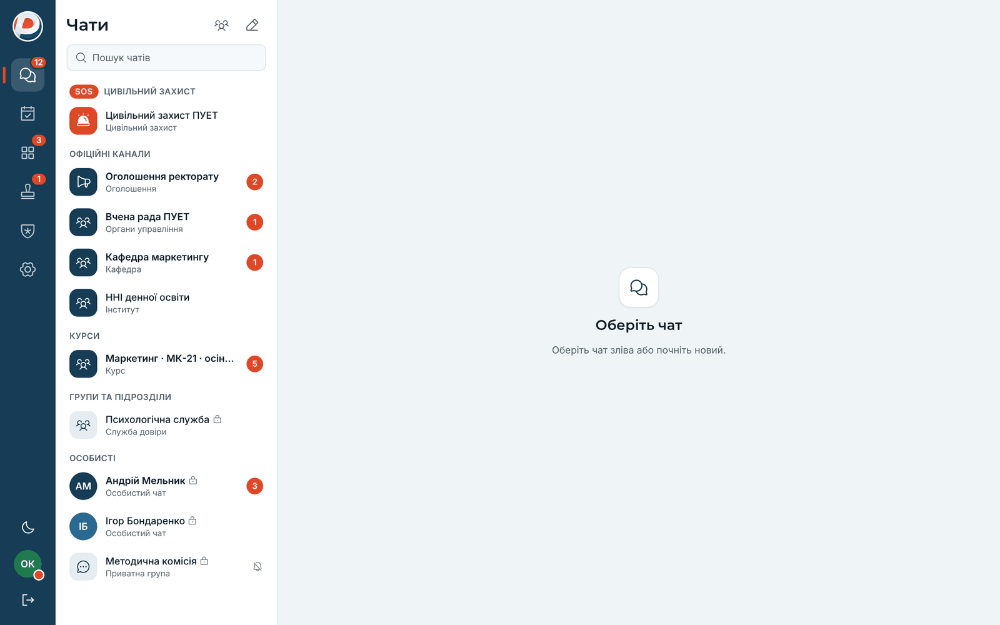
*Рис. 2. Головний екран: панель розділів ліворуч, список чатів і область листування*

## Чати і канали

Більшість каналів з'являється сама, відповідно до вашого місця в
університеті:

- **Цивільний захист** — термінові сповіщення. Вони надходять завжди, навіть у
  «Тихі години» і в режимі «Не турбувати».
- **Офіційні канали** — академічна група, інститут, кафедра, підрозділ.
  Оголошення в них публікують лише модератори.
- **Курси** — канал кожної дисципліни семестру з викладачами й групами.
  Викладач пише теми, студенти відповідають у тредах («Відповісти в треді»).
  Наприкінці семестру курс переходить в архів лише для читання.
- **Групи та підрозділи** і **Особисті** — ваші власні чати.

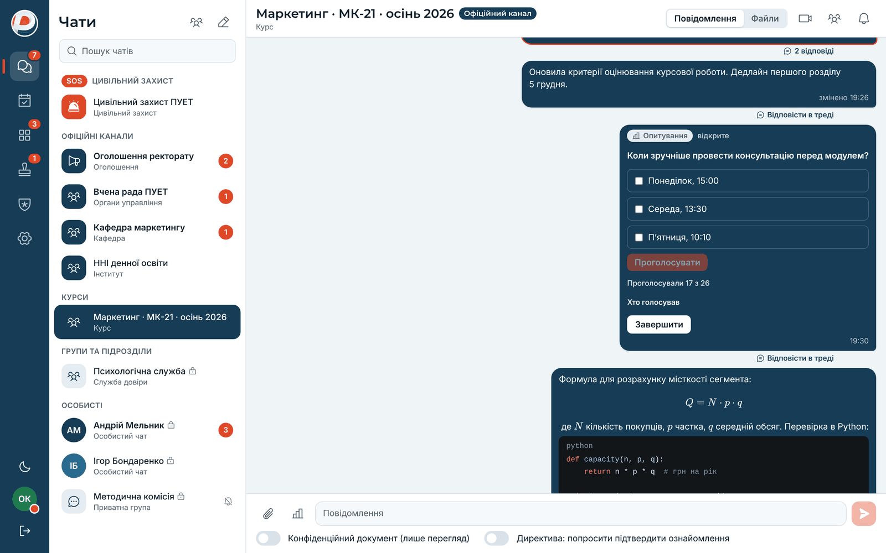
*Рис. 3. Канал курсу: повідомлення викладача, кнопка «Відповісти в треді», поле повідомлення з перемикачами «Конфіденційний документ» і «Директива»*

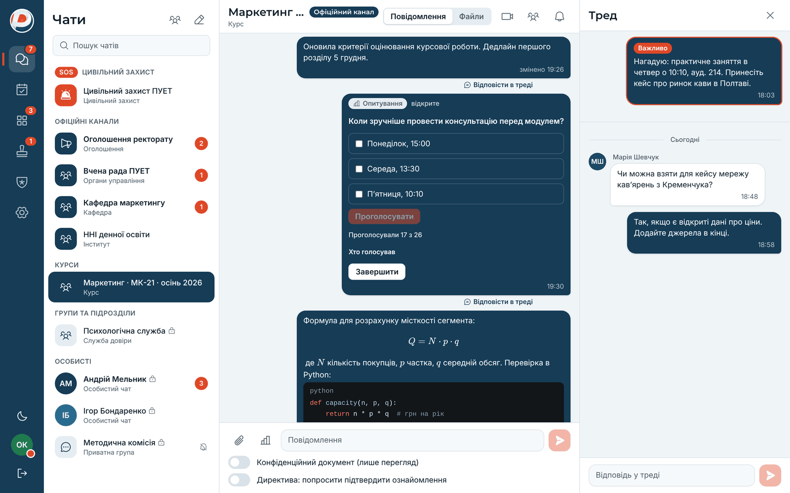
*Рис. 4. Тред праворуч від каналу курсу: відповіді студентів на тему викладача*

Щоб написати колезі, натисніть «Новий чат» (олівець угорі) і знайдіть людину.
Для групового чату натисніть «Нова група». Деякі обмеження вмикаються
автоматично:

- студенти пишуть викладачам лише зі спільного курсу поточного семестру;
- студенти не можуть писати напряму ректорату;
- службам довіри (омбудсмен, психологічна служба) писати може кожен.

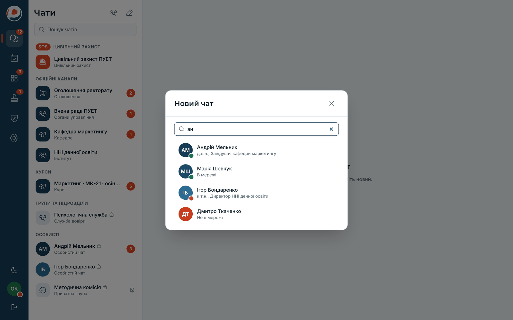
*Рис. 5. Вікно «Новий чат»: пошук колеги за прізвищем*

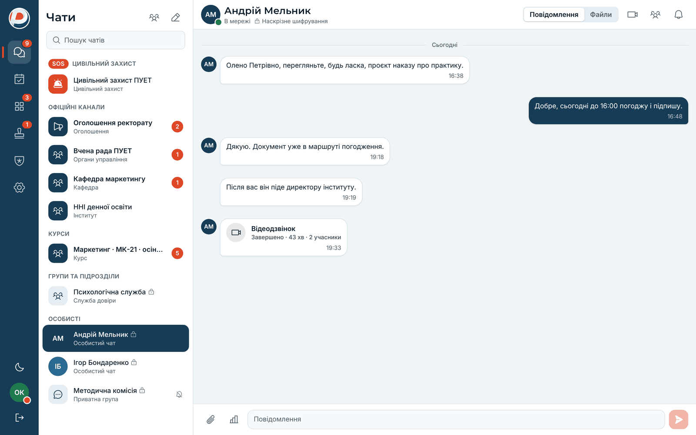
*Рис. 6. Особистий чат з колегою*

Повідомлення з позначкою «Важливо» виділяються. **Директива** — повідомлення,
ознайомлення з яким треба підтвердити кнопкою «Ознайомлений». Автор бачить,
хто вже ознайомився.

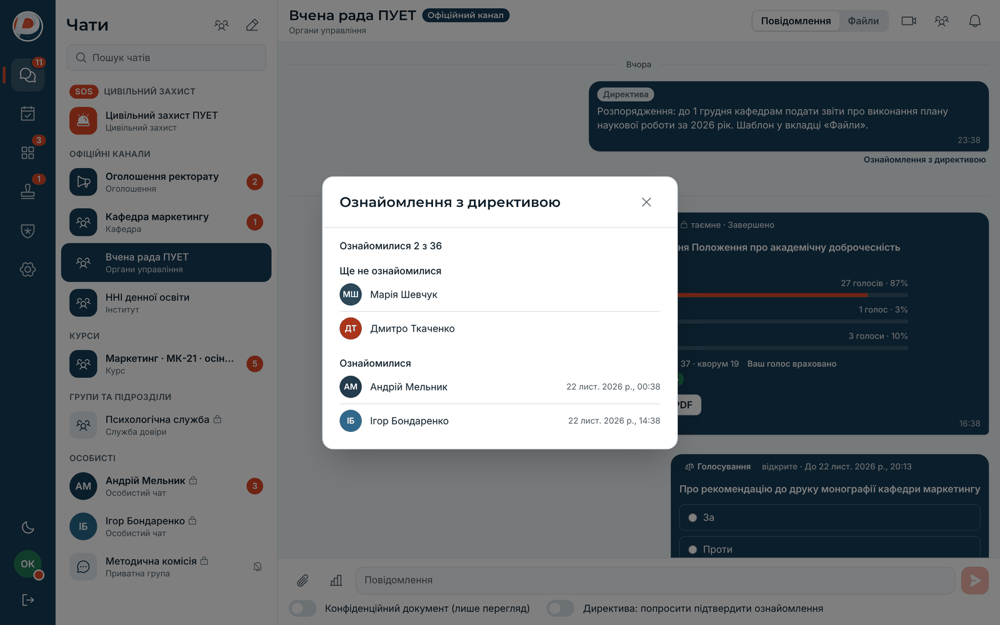
*Рис. 7. Директива: автор бачить, хто ознайомився, а хто ще ні*

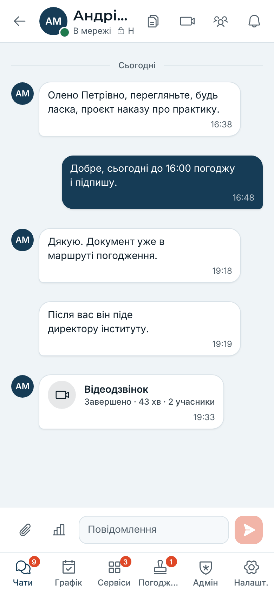
*Рис. 8. Той самий чат на телефоні: розділи внизу екрана*

### Наскрізне шифрування

Особисті чати й групи можна створювати з увімкненим «Наскрізним
шифруванням». Тоді текст бачать лише учасники: сервер і адміністратори його не
читають. У таких чатах можна ввімкнути «Зникаючі повідомлення»: вони
видаляються через 1 годину, 24 години або 7 днів.

Ключі шифрування зберігаються на вашому пристрої. Щоб не втратити історію при
зміні пристрою, увімкніть у «Налаштуваннях» резервну копію ключів і
запам'ятайте майстер-фразу. Без неї історію зашифрованих чатів відновити
неможливо, навіть IT-центру. Новий пристрій можна підтвердити QR-кодом зі
старого.

Канали служб довіри, закриті кімнати ректорату й військового обліку завжди
зашифровані.

## Файли і документи

- «Прикріпити файл» у полі повідомлення. Дозволені PDF, зображення, текст і
  документи Office без макросів.
- Кожен файл спершу перевіряє антивірус, тому він з'являється в чаті за
  кілька секунд. Файл із вірусом відхиляється.
- PDF відкриваються у захищеному переглядачі з мініатюрами сторінок, змістом,
  пошуком і закладками. Небезпечний вміст (скрипти, форми, зовнішні посилання)
  з PDF видаляється.
- **Конфіденційний документ (лише перегляд)** не можна завантажити,
  роздрукувати чи скопіювати. На кожній сторінці є водяний знак з вашим іменем,
  службовим ID, IP-адресою і часом перегляду.
- «Переслати» відправляє файл в інший чат. Документи Канцелярії, кадрів,
  фінансів і юристів пересилаються лише в межах свого підрозділу, а
  конфіденційні не пересилаються зовсім.
- У зашифрованих чатах файл шифрується на вашому пристрої. Сервер не може
  перевірити його антивірусом, тому відкривайте лише файли від людей, яким
  довіряєте.

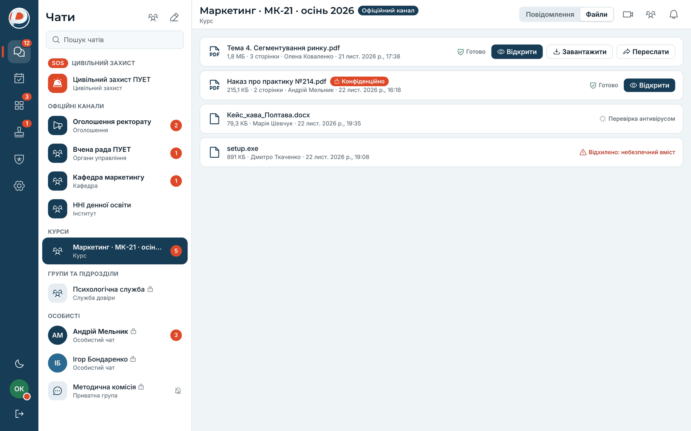
*Рис. 9. Вкладка «Файли» каналу: стан перевірки, позначки «Конфіденційний» і «Підписано ЕП»*

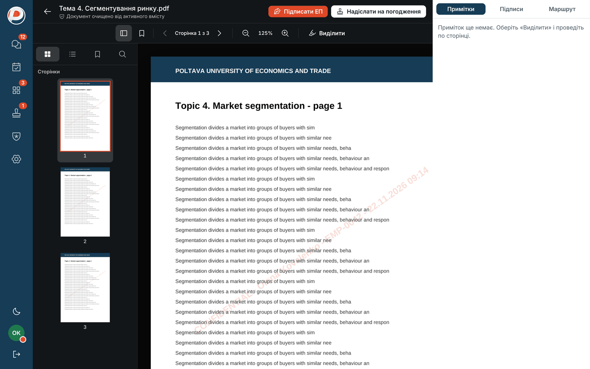
*Рис. 10. Захищений переглядач PDF: мініатюри сторінок, пошук, закладки і кнопка «Підписати ЕП»*

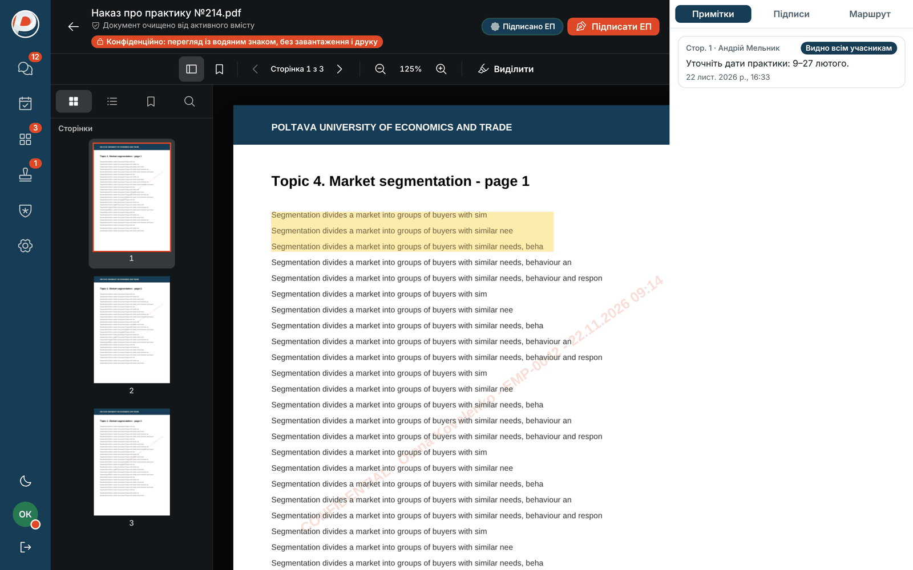
*Рис. 11. Конфіденційний документ: лише перегляд, водяний знак з іменем, службовим ID, IP і часом*

## Електронний підпис і погодження

1. У «Налаштуваннях» → «Електронний підпис» натисніть «Створити сертифікат
   УЕП». Ключ створюється лише на вашому пристрої і ніколи його не залишає.
   Кваліфікований підпис (КЕП) підключається через сертифікований шлюз, якщо
   його налаштував IT-центр.
2. Відкрийте PDF і натисніть «Підписати ЕП». На документі з'явиться штамп з
   QR-кодом. За кодом будь-хто може перевірити підпис на сторінці перевірки.
3. «Маршрут погодження» відправляє документ кільком людям по черзі. Кожен
   погоджувач бачить його в розділі «Погодження» і натискає «Погодити» або
   «Підписати і погодити».

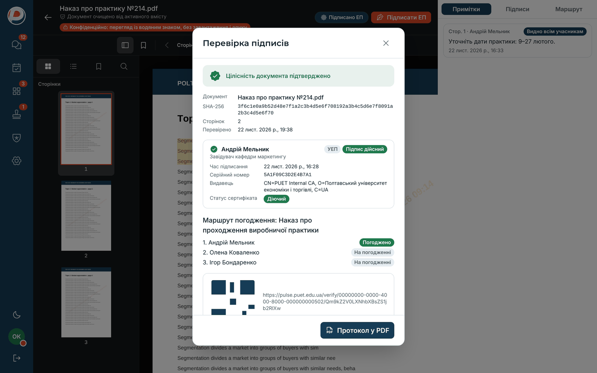
*Рис. 12. Перевірка підпису: підписанти, сертифікат, маршрут погодження і QR-код для перевірки*

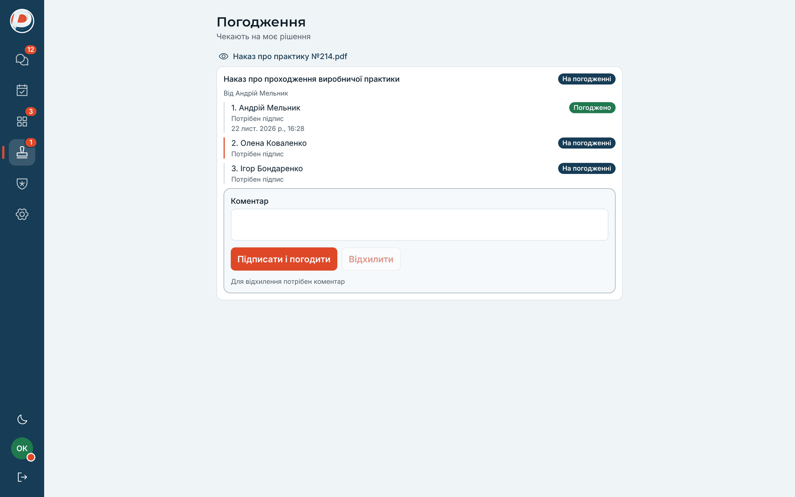
*Рис. 13. Розділ «Погодження»: документ, що чекає вашого рішення, і кнопка «Підписати і погодити»*

Внутрішній підпис має статус УЕП згідно з Регламентом ЕДО ПУЕТ.

## Опитування і голосування

- **Опитування** створюється з поля повідомлення («Створити опитування»). В
  офіційних каналах їх відкривають модератори.
- **Формальне голосування** призначене для колегіальних органів (Вчена рада
  тощо). Варіанти відповіді: «За», «Проти», «Утримався». Голосування може бути
  таємним, з кворумом. Після закриття формується протокол у PDF.
- У зашифрованих чатах опитування теж зашифровані, і голоси бачать учасники
  чату.

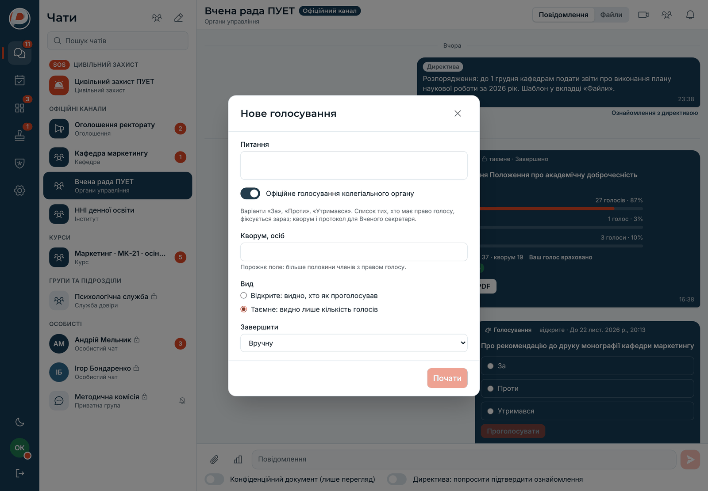
*Рис. 14. Вікно «Нове опитування»: питання, варіанти і режим голосування*

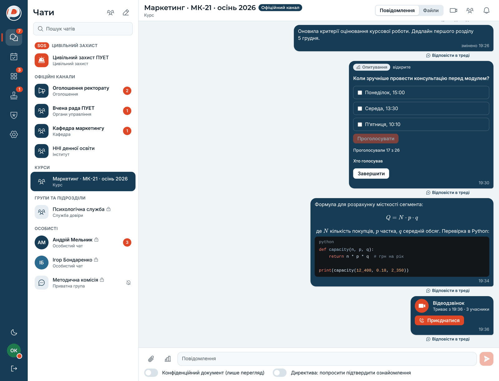
*Рис. 15. Опитування в каналі курсу: голосування, кількість учасників і кнопка «Завершити»*

## Дзвінки і консультації

- «Почати відеодзвінок» у чаті запускає дзвінок для учасників. Доступні
  камера, мікрофон і демонстрація екрана. В офіційних каналах і курсах дзвінки
  починають модератори.
- **Консультації**: викладачі публікують слоти, студенти натискають
  «Записатися». Кімната відкривається за 10 хвилин до початку. Тему
  консультації бачить лише викладач.

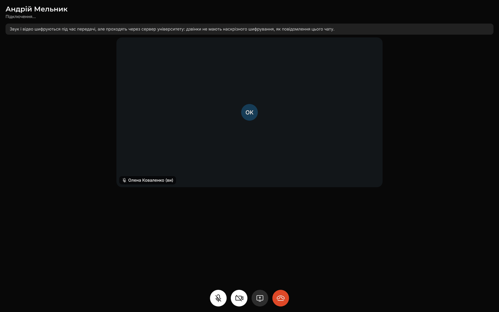
*Рис. 16. Кімната відеодзвінка: камера, мікрофон, демонстрація екрана і завершення*

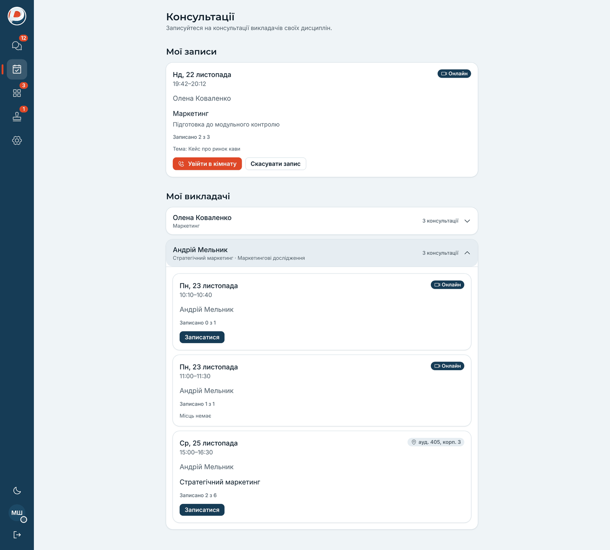
*Рис. 17. Консультації: вільні слоти викладачів, кнопка «Записатися» і ваші записи*

## Сервіси

- **Деканат**: замовлення довідок і їхній стан.
- **Розклад ПУЕТ**: зміни аудиторій і перенесення пар.
- **Сервіс-деск АГР та ІТ**: заявки на ремонт у корпусах і гуртожитках.
  Номер кімнати бачать лише заявник і комендант.
- **ЕДО та Канцелярія**: погодження наказів і реєстрація документів.
- **Консультант приймальної комісії**: відповіді за правилами прийому з
  цитатами з них.
- **Анонімне звернення**: до омбудсмена, психологічної або іншої служби
  довіри. Для кожного звернення створюється окремий псевдонім. Служба бачить
  лише його, а не ваше ім'я, групу чи посаду. Листування зашифроване.

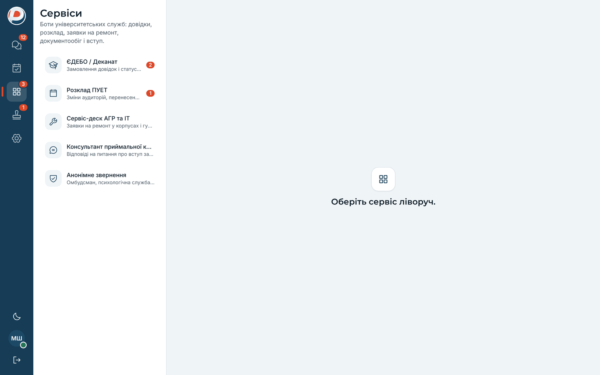
*Рис. 18. Розділ «Сервіси»: боти університетських служб*

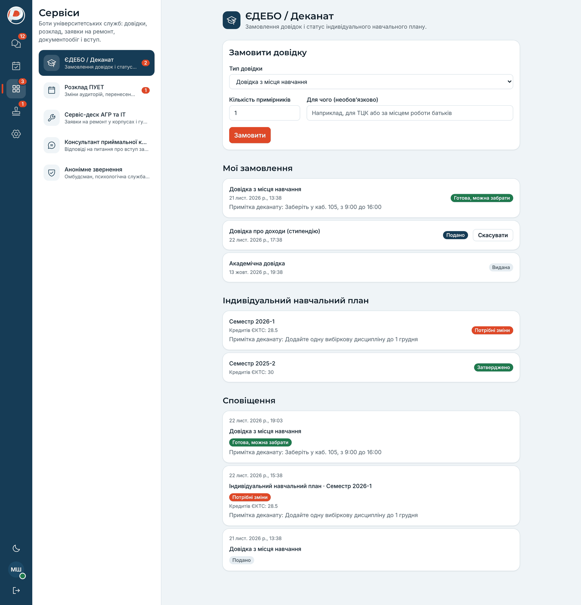
*Рис. 19. Деканат: замовлення довідки та її стан*

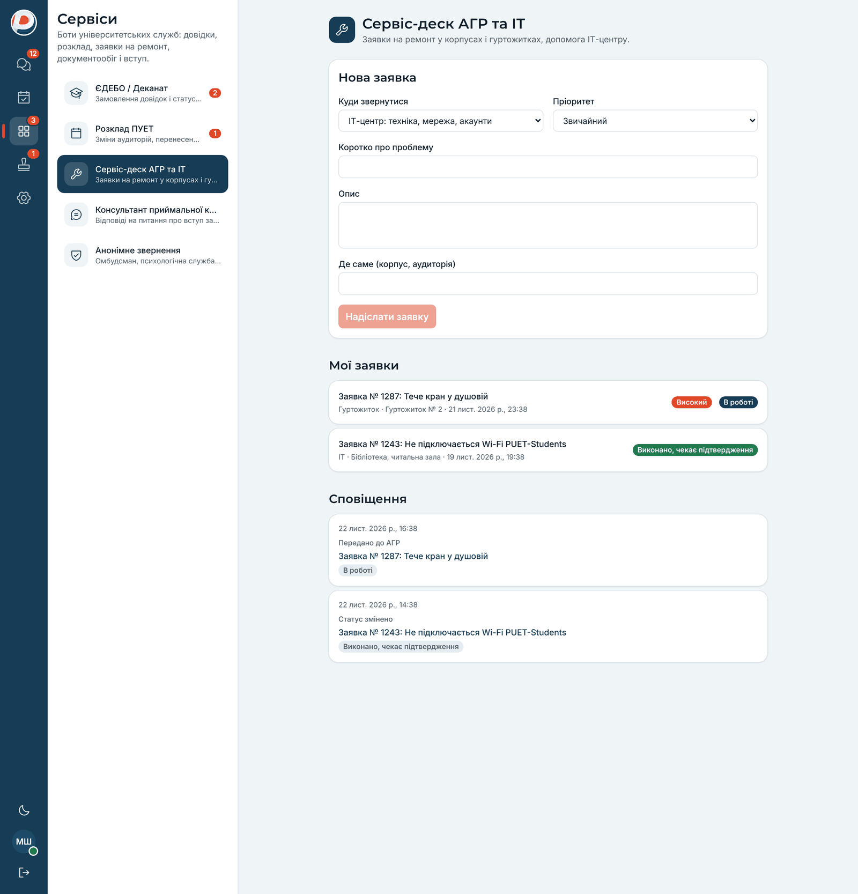
*Рис. 20. Сервіс-деск АГР та ІТ: нова заявка і стан ваших заявок*

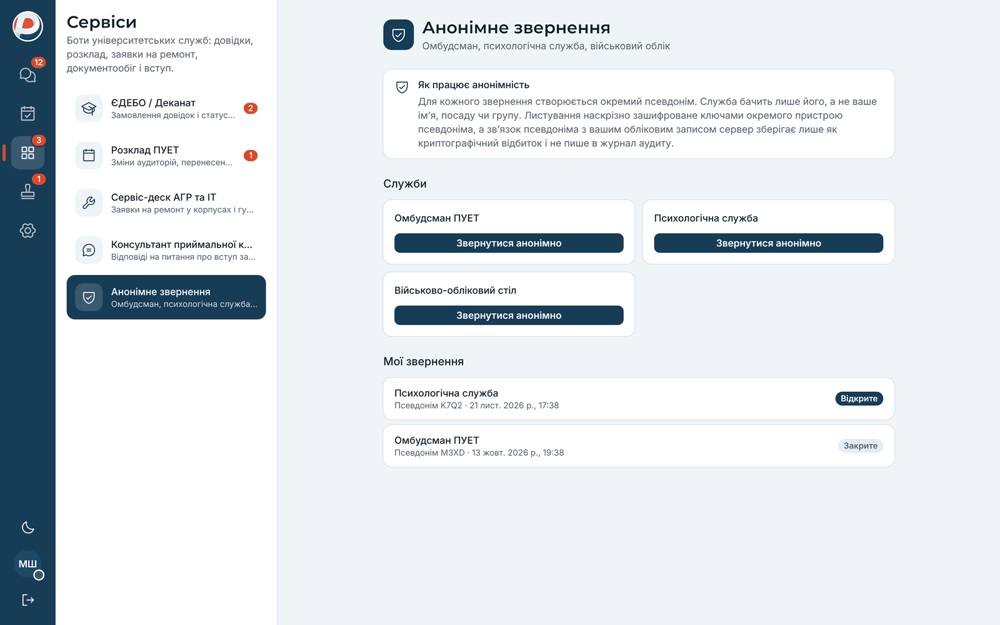
*Рис. 21. Анонімне звернення: вибір служби довіри*

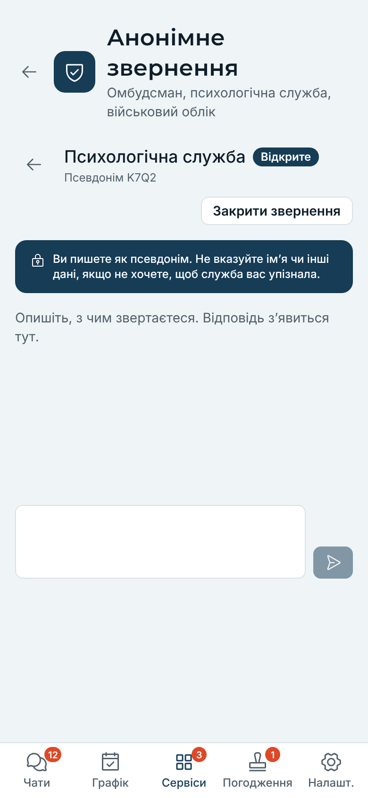
*Рис. 22. Анонімний зашифрований чат зі службою: служба бачить лише псевдонім*

## Статус і сповіщення

- Статус («На парі», «На засіданні», «У відрядженні», «Не турбувати»)
  ставиться через аватар. Поки він діє, сповіщення не турбують вас.
- **Тихі години** в «Налаштуваннях»: сповіщення в цей час збираються в
  ранковий дайджест.
- Тривоги цивільного захисту надходять завжди.

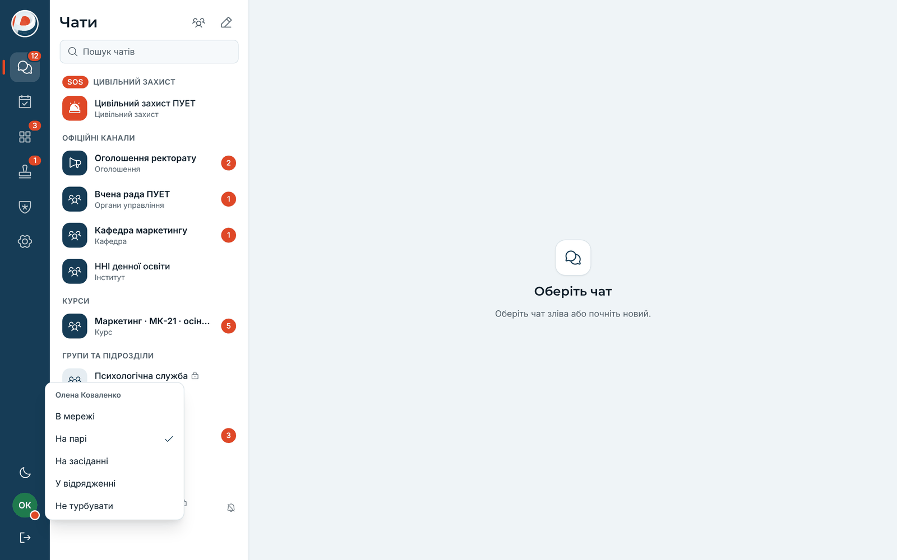
*Рис. 23. Меню статусу під аватаром: «На парі», «Не турбувати» тощо*

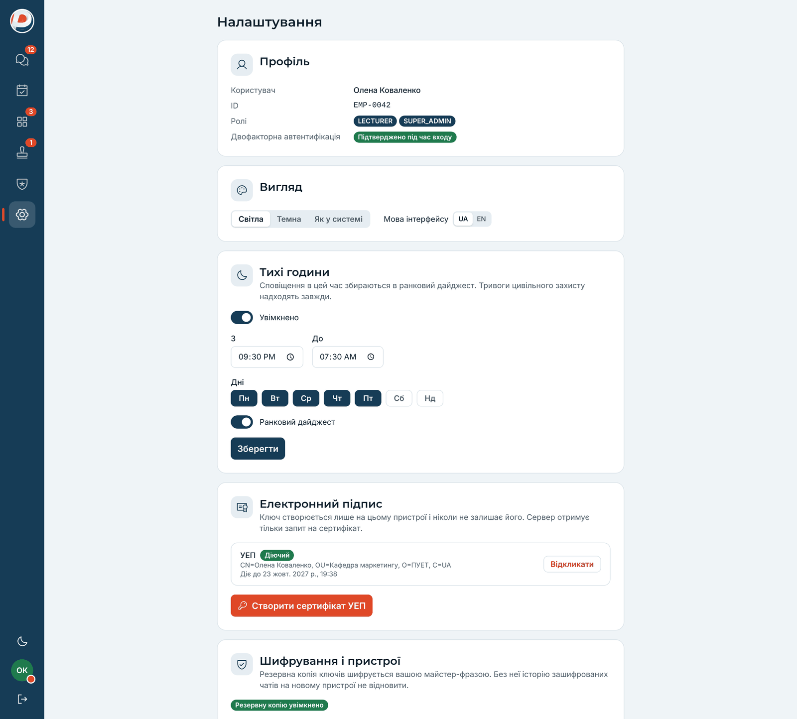
*Рис. 24. Налаштування: профіль, вигляд, тихі години, електронний підпис, шифрування і пристрої*

## Неповнолітні (ліцей та студенти до 18 років)

Для неповнолітніх діють додаткові правила:

- писати їм можуть працівники й учасники спільних груп;
- у довіднику вони бачать лише своє оточення;
- повідомлення з нецензурною лексикою або посиланнями на сторонні сайти не
  надсилаються. Дозволені сайти університету.

## Для адміністраторів

У розділі «Адміністрування» є вкладки:

- **Структура** — інститути, кафедри, підрозділи, гуртожитки;
- **Ролі** — призначення ролей; свої ролі змінювати не можна;
- **Матриця дозволів** і **Політики ABAC** — хто що може робити;
- **Симулятор доступу** — перевірка, чи дозволена дія людині, і чому;
- **Журнал аудиту** — незмінний журнал дій з перевіркою ланцюжка хешів.

Приватні й зашифровані чати адміністраторам не видно. Ролі з кадрової
системи змінюються лише там, а не в панелі.

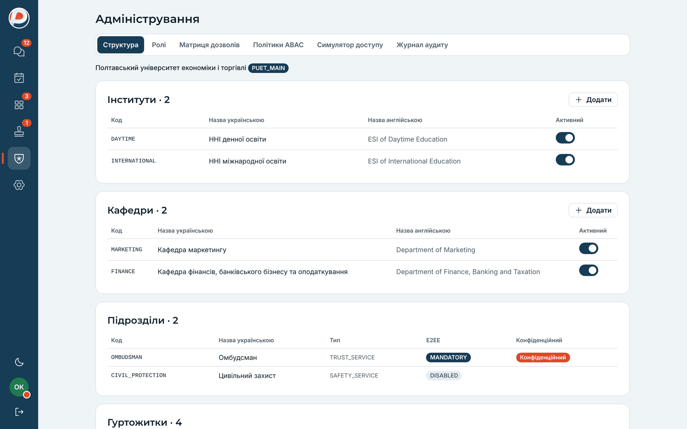
*Рис. 25. Адміністрування, вкладка «Структура»: інститути, кафедри, підрозділи*

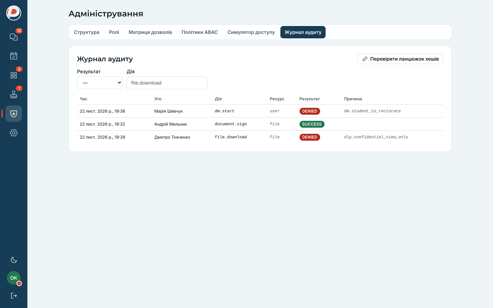
*Рис. 26. Журнал аудиту з фільтрами і перевіркою ланцюжка хешів*

## Безпека: що варто пам'ятати

- IT-центр ніколи не просить ваш пароль, код автентифікатора чи майстер-фразу.
- Не встановлюйте месенджер з неофіційних джерел.
- Втратили телефон з автентифікатором або ноутбук? Одразу повідомте IT-центр.
